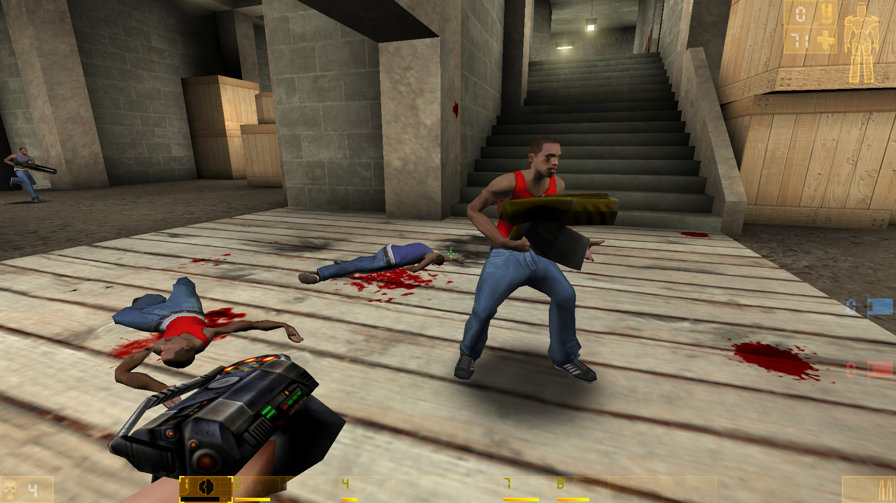

# **CJ playermodel** #
Unreal Tournament 99 Playermodel.

Carl Johnson from GTA:SA in UT99

## 📸 Screenshots

  

## 📥 Installation

Download and extract `Shipment.rar` into your Unreal Tournament installation directory.

## 📝 Notes
- **Dependencies:** The custom playermodel heavily relies on `SkeletalChars.u` package, which was added with `Unreal Tournament Bonus Pack #4`. this is the reason why i could in any way import a skeletalmesh into ut99
- Unfortunately because of skeletalmesh usage, the character doesn't lose head on a headshot.
- For now, CJ has no custom voice sounds and uses random character or nali sounds
---

  Part of <a href="https://github.com/SUND1O/My-UT99-Stuff">My-UT99-Stuff</a>

