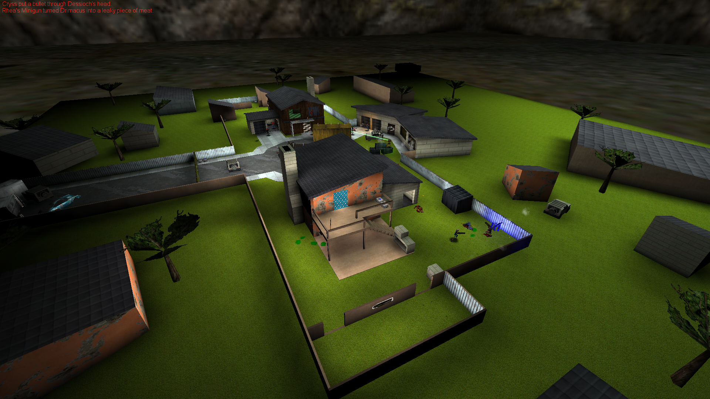
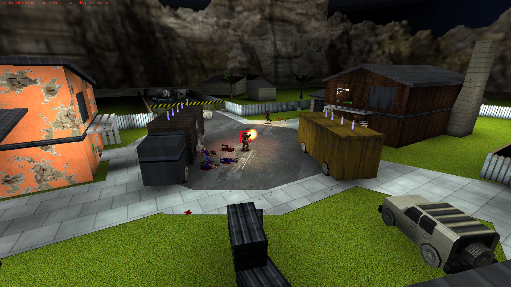

# **Nuketown** #
A custom Unreal Tournament 99 level.

This is a rough recreation of "Nuketown" map from CoD games.

Map is created in Deathmatch, CTF and Domination variants

## 📸 Screenshots

  
  

## 📥 Installation

Download and extract `Nuketown.rar` into your Unreal Tournament installation directory.

## 📝 Notes
- **Dependencies:** The map uses native textures from `city.utx`,`genfluid.utx`,`metalmys.utx`,`egyptpan.utx`,`skybox.utx`
---

  Part of <a href="https://github.com/SUND1O/My-UT99-Stuff">My-UT99-Stuff</a>

